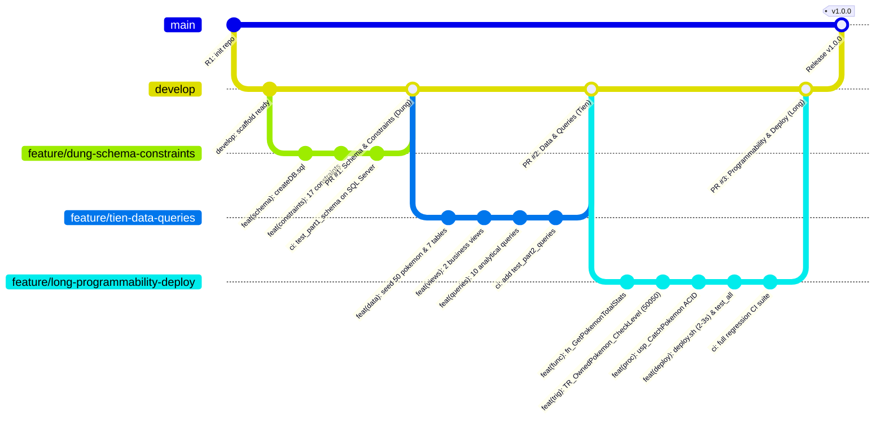

# Pokémon World Database — Hệ Thống Quản Lý Thế Giới Pokémon

> **Môn học**: DBI202 — Database Systems  
> **Dự án**: Bài tập lớn thực hành thiết kế, xây dựng và quản trị CSDL quan hệ  
> **Hệ quản trị CSDL**: Microsoft SQL Server 2022 (Docker Container)  
> **Phương pháp quản lý mã nguồn**: Git Flow chuẩn công nghiệp với CI/CD tự động  

---

## 1. Giới thiệu dự án & Thông tin nhóm phát triển

Dự án **Pokémon World Database** xây dựng hệ thống cơ sở dữ liệu quan hệ hoàn chỉnh nhằm mô phỏng và quản lý thế giới Pokémon sống động. Hệ thống quản lý toàn diện các vùng đất (*Region*), địa điểm khám phá (*Location*), từ điển các loài Pokémon với chỉ số chiến đấu (*Pokemon*), hồ sơ nhà huấn luyện (*Trainer*), phân bố sinh vật hoang dã (*WildEncounter*), đội hình Pokémon sở hữu (*OwnedPokemon*), và sổ tay theo dõi Pokédex cá nhân (*PersonalPokedex*).

Dự án được thực hiện bởi nhóm 3 sinh viên, áp dụng quy trình phát triển chuyên nghiệp theo mô hình **Git Flow**, kiểm thử tự động hóa với **GitHub Actions** và triển khai tự động bằng bash script:

| STT | Họ và Tên | Vai trò chính | Email / Git Identity | Trách nhiệm & Hạng mục đảm nhiệm |
|:---:|---|---|---|---|
| 1 | **Nguyễn Văn Dũng** | Leader / Database Architect | `Nguyen Van Dung <dung.nv@fpt.edu.vn>` | Thiết kế mô hình quan hệ chuẩn hóa 3NF, viết mã DDL khởi tạo 7 bảng (`createDB.sql`), thiết lập 17 ràng buộc toàn vẹn (`constraints.sql`), khởi tạo GitHub Actions CI Pipeline ban đầu. |
| 2 | **Trần Minh Tiến** | Data Engineer / BI Analyst | `Tran Minh Tien <tien.tm@fpt.edu.vn>` | Nạp dữ liệu 50 loài Pokémon chuẩn Gen-1 và dữ liệu mẫu đầy đủ cho 7 bảng (`insert.sql`), thiết kế 2 khung nhìn nghiệp vụ (`views.sql`), phát triển 10 câu truy vấn báo cáo phân tích nâng cao (`queries.sql`). |
| 3 | **Hoàng Phi Long** | Senior Database Developer / DevOps Lead | `Hoang Phi Long <long.hp@fpt.edu.vn>` | Lập trình T-SQL nâng cao: Scalar Function tính tổng chỉ số (`function.sql`), Trigger kiểm tra cấp độ bắt mã lỗi 50050 (`trigger.sql`), Stored Procedure thu phục Pokémon giao dịch ACID (`procedure.sql`), bộ test tích hợp (`test_all.sql`), script triển khai 1 lệnh `deploy.sh` (2-3s), hoàn thiện CI/CD pipeline. |

---

## 2. Quy trình phát triển Git Flow

Nhóm áp dụng mô hình phân nhánh Git Flow chặt chẽ. Mỗi thành viên làm việc độc lập trên nhánh tính năng (`feature/*`) tương ứng với phân công nhiệm vụ, tích hợp kiểm thử tự động trên GitHub Actions trước khi mở Pull Request để các thành viên khác bình duyệt (peer-review) và phê duyệt sáp nhập (merge) vào nhánh `develop`.



### Các nhánh trong hệ thống:
- **`main`**: Nhánh lưu trữ phiên bản sản phẩm hoàn thiện, ổn định nhất để nộp bài tập lớn (được gắn tag `v1.0.0`).
- **`develop`**: Nhánh trung tâm phản ánh trạng thái tích hợp mới nhất của toàn đội.
- **`feature/dung-schema-constraints`**: Nhánh tính năng của Dũng cho DDL 7 bảng và 17 ràng buộc.
- **`feature/tien-data-queries`**: Nhánh tính năng của Tiến cho bộ dữ liệu mẫu, 2 views và 10 queries.
- **`feature/long-programmability-deploy`**: Nhánh tính năng của Long cho T-SQL nâng cao, test tích hợp và bộ kịch bản triển khai tự động.

---

## 3. Kiến trúc CSDL Quan hệ chuẩn hóa 3NF

Cơ sở dữ liệu bao gồm **7 thực thể bảng** được chuẩn hóa nghiêm ngặt đạt **Dạng Chuẩn 3 (Third Normal Form - 3NF)**, triệt tiêu hoàn toàn dư thừa dữ liệu (redundancy) và đảm bảo tính nhất quán (data integrity).

### 3.1. Sơ đồ Thực thể Liên kết (Relational Schema)

```
+--------------------+        +--------------------+
|       Region       |        |      Pokemon       |
+--------------------+        +--------------------+
| PK  RegionID       |        | PK  PokemonID      |
|     Name (UQ)      |        |     NationalDexNumber(UQ)
|     Description    |        |     Name (UQ)      |
+---------+----------+        |     PrimaryType    |
          | 1                 |     SecondaryType  |
          |                   |     BaseHP         |
          | N                 |     BaseAttack     |
+---------+----------+        |     BaseDefense    |
|      Location      |        +----+----+----+-----+
+--------------------+             |    |    |
| PK  LocationID     |             |    |    |
| FK  RegionID       |             |    |    |
|     Name           |             |    |    |
|     LocationType   |             |    |    |
+----+---------+-----+             |    |    |
     |         |                   |    |    |
     | 1       | 1                 | 1  | 1  | 1
     |         |                   |    |    |
     | N       | N                 | N  | N  | N
+----+----+  +-+-------------------+--+ | +--+----------------------+
| Trainer |  |     WildEncounter      | | |      OwnedPokemon       |
+---------+  +------------------------+ | +-------------------------+
|PK Trainr|  | PK  EncounterID        | | | PK  OwnedPokemonID      |
|  User(UQ)  | FK  LocationID         | | | FK  TrainerID           |
|  Email(UQ) | FK  PokemonID ---------+ | | FK  PokemonID ----------+
|FK LocID |  |     MinLevel           | | |     Nickname            |
+----+----+  |     MaxLevel           | | |     Level               |
     |       +------------------------+ | |     PartySlot           |
     | 1                                | +------------+------------+
     |                                  |              |
     +----------------------------------|--------------+
     | 1                                | 1
     |                                  |
     | N                                | N
+----+----------------------------------+---+
|              PersonalPokedex              |
+-------------------------------------------+
| PK,FK TrainerID                           |
| PK,FK PokemonID --------------------------+
|       FirstSeenAt                         |
|       IsCaught                            |
+-------------------------------------------+
```

### 3.2. Bảng mô tả chi tiết 7 thực thể

| Tên bảng | Khóa chính (PK) | Thuộc tính chính & Khóa ngoại (FK) | Ràng buộc nghiệp vụ & Chuẩn hóa |
|---|---|---|---|
| **Region** | `RegionID` (INT IDENTITY) | `Name` NVARCHAR(50), `Description` NVARCHAR(255) | Tên vùng là duy nhất (`UQ_Region_Name`). Mỗi vùng chứa nhiều địa điểm. |
| **Location** | `LocationID` (INT IDENTITY) | `RegionID` (FK -> Region), `Name` NVARCHAR(100), `LocationType` VARCHAR(20) | Thuộc về một Region xác định. `FK_Location_Region` đảm bảo tính toàn vẹn tham chiếu. |
| **Pokemon** | `PokemonID` (INT IDENTITY) | `NationalDexNumber` INT, `Name` NVARCHAR(50), `PrimaryType` VARCHAR(20), `SecondaryType` VARCHAR(20), `BaseHP` INT, `BaseAttack` INT, `BaseDefense` INT | `NationalDexNumber` và `Name` là duy nhất (`UQ_Pokemon_Dex`, `UQ_Pokemon_Name`). `CK_Pokemon_BaseHP` đảm bảo `BaseHP > 0`. |
| **Trainer** | `TrainerID` (INT IDENTITY) | `Username` NVARCHAR(50), `Email` VARCHAR(100), `LocationID` (FK -> Location) | `Username` và `Email` duy nhất (`UQ_Trainer_Username`, `UQ_Trainer_Email`). `LocationID` liên kết đến địa điểm hiện tại. |
| **WildEncounter** | `EncounterID` (INT IDENTITY) | `LocationID` (FK -> Location), `PokemonID` (FK -> Pokemon), `MinLevel` INT, `MaxLevel` INT | Liên kết M-N giữa Location và Pokemon. `CK_WildEncounter_Level`: `MinLevel > 0 AND MinLevel <= MaxLevel AND MaxLevel <= 100`. |
| **OwnedPokemon** | `OwnedPokemonID` (INT IDENTITY) | `TrainerID` (FK -> Trainer), `PokemonID` (FK -> Pokemon), `Nickname` NVARCHAR(50), `Level` INT, `PartySlot` INT | Quản lý Pokémon của Trainer. `CK_OwnedPokemon_Level` (`1..100`), `CK_OwnedPokemon_PartySlot` (`NULL` hoặc `1..6`). |
| **PersonalPokedex** | `TrainerID, PokemonID` (Composite PK) | `TrainerID` (FK -> Trainer), `PokemonID` (FK -> Pokemon), `FirstSeenAt` DATETIME, `IsCaught` BIT | Quản lý sổ tay Pokédex cá nhân của từng Trainer. Khóa chính kết hợp `(TrainerID, PokemonID)`. Theo dõi thời điểm gặp đầu tiên (`FirstSeenAt`) và trạng thái bắt (`IsCaught = 1`). |

---

## 4. Tóm tắt các thành phần kỹ thuật cốt lõi

### 4.1. 17 Ràng buộc toàn vẹn (`constraints.sql`)
- **7 Khóa chính (PK)**: Khởi tạo độc lập trên từng bảng trong `createDB.sql`.
- **8 Khóa ngoại (FK)**: 
  1. `FK_Location_Region`
  2. `FK_Trainer_Location`
  3. `FK_Encounter_Location`
  4. `FK_Encounter_Pokemon`
  5. `FK_Owned_Trainer`
  6. `FK_Owned_Pokemon`
  7. `FK_Pokedex_Trainer`
  8. `FK_Pokedex_Pokemon`
- **4 Ràng buộc miền giá trị (CHECK)**:
  1. `CK_Pokemon_BaseHP`: Sinh lực gốc `BaseHP > 0`.
  2. `CK_OwnedPokemon_Level`: Cấp độ Pokémon `[Level] BETWEEN 1 AND 100`.
  3. `CK_OwnedPokemon_PartySlot`: Vị trí đội hình `PartySlot IS NULL OR PartySlot BETWEEN 1 AND 6`.
  4. `CK_WildEncounter_Level`: Cấp độ hoang dã hợp lệ `MinLevel > 0 AND MinLevel <= MaxLevel AND MaxLevel <= 100`.
- **5 Ràng buộc duy nhất (UNIQUE)**:
  1. `UQ_Region_Name` (Region.Name)
  2. `UQ_Pokemon_Dex` (Pokemon.NationalDexNumber)
  3. `UQ_Pokemon_Name` (Pokemon.Name)
  4. `UQ_Trainer_Username` (Trainer.Username)
  5. `UQ_Trainer_Email` (Trainer.Email)

### 4.2. 2 Khung nhìn nghiệp vụ (`views.sql`)
1. **`dbo.vw_TrainerParty`**: Trực quan hóa danh sách đội hình chiến đấu (tối đa 6 Pokémon) của tất cả huấn luyện viên, hiển thị chi tiết tên huấn luyện viên, số thứ tự slot (1-6), tên loài, biệt danh và cấp độ.
2. **`dbo.vw_PokedexProgress`**: Báo cáo tổng hợp tiến độ hoàn thành Pokédex cá nhân của từng huấn luyện viên, bao gồm tổng số loài đã gặp, tổng số loài đã bắt, tổng số loài hiện có trong hệ thống và tỷ lệ phần trăm hoàn thành.

### 4.3. 10 Truy vấn nghiệp vụ nâng cao (`queries.sql`)
- **Q1 (INNER JOIN 4 bảng)**: Phân bố loài Pokémon hoang dã theo từng địa điểm và vùng địa lý.
- **Q2 (INNER JOIN 3 bảng)**: Danh sách Pokémon đang nằm trong đội hình chiến đấu kèm chỉ số cơ bản.
- **Q3 (LEFT OUTER JOIN)**: Thống kê tất cả địa điểm và số lượng loài hoang dã (bao gồm cả địa điểm chưa có Pokémon).
- **Q4 (LEFT OUTER JOIN)**: Thống kê mức độ phổ biến của từng loài Pokémon trong toàn bộ cộng đồng huấn luyện viên.
- **Q5 (Subquery trong WHERE)**: Tìm các huấn luyện viên đang sở hữu Pokémon có cấp độ vượt mức trung bình toàn hệ thống.
- **Q6 (Subquery trong WHERE)**: Lọc các loài Pokémon có tổng chỉ số cơ bản (`BaseHP + BaseAttack + BaseDefense`) cao hơn mức trung bình của toàn bộ Pokédex.
- **Q7 (Subquery trong FROM - Derived Table)**: Xếp hạng các huấn luyện viên có Pokémon mạnh nhất sở hữu cấp độ tối đa từ 25 trở lên.
- **Q8 (Subquery trong FROM - Derived Table)**: Đánh giá độ khó trung bình của các vùng dựa trên dải cấp độ hoang dã.
- **Q9 (GROUP BY với HAVING)**: Phân tích chỉ số sinh lực trung bình theo hệ chính, lọc ra các hệ có từ 2 loài trở lên.
- **Q10 (GROUP BY với HAVING)**: Vinh danh các nhà nghiên cứu tích cực đã thu thập được từ 2 loài Pokémon trở lên trong sổ tay cá nhân.

### 4.4. 3 Đơn vị Lập trình T-SQL Nâng cao
1. **Scalar Function (`function.sql`) — `dbo.fn_GetPokemonTotalStats (@PokemonID INT)`**:
   - Hàm vô hướng tính toán tổng chỉ số sức mạnh cơ bản (`BaseHP + BaseAttack + BaseDefense`).
   - Xử lý biên: Trả về `0` nếu không tìm thấy mã Pokémon.
2. **Business Trigger (`trigger.sql`) — `dbo.TR_OwnedPokemon_CheckLevel`**:
   - Kích hoạt sự kiện `AFTER INSERT, UPDATE` trên bảng `dbo.OwnedPokemon`.
   - Kiểm tra bảng ảo `inserted`: Nếu có bất kỳ dòng nào có `Level < 1` hoặc `Level > 100`, lập tức `ROLLBACK TRANSACTION` và kích hoạt biệt lệ có cấu trúc với mã lỗi chuẩn **50050**.
3. **Transactional Stored Procedure (`procedure.sql`) — `dbo.usp_CatchPokemon`**:
   - Quản lý giao dịch thu phục Pokémon tuân thủ nghiêm ngặt chuẩn **ACID**.
   - Kiểm tra tính hợp lệ của Trainer và địa điểm xuất hiện hoang dã.
   - Thêm bản ghi vào `OwnedPokemon`, tự động đồng bộ trạng thái `IsCaught = 1` trong `PersonalPokedex` bằng cấu trúc `MERGE / Upsert`.
   - Cơ chế bẫy lỗi `TRY...CATCH` tự động `ROLLBACK TRANSACTION` khi xảy ra sự cố và xuất mã định danh `@NewOwnedPokemonID` qua tham số `OUTPUT`.

---

## 5. Hướng dẫn cài đặt & Triển khai nhanh

### 5.1. Yêu cầu môi trường
- Hệ điều hành: Linux / macOS / Windows (WSL2).
- Docker Engine & Docker Compose (Container `sqlserver` chạy Microsoft SQL Server 2022).
- Công cụ dòng lệnh: `bash`, `docker`, `git`.

### 5.2. Triển khai tự động 1 lệnh với `deploy.sh`
Toàn bộ quy trình từ kiểm tra kết nối, dựng CSDL, áp dụng ràng buộc, nạp dữ liệu đến cài đặt hàm/thủ tục/trigger và chạy toàn bộ test kiểm thử tích hợp được tự động hóa qua script `deploy.sh`:

```bash
# Cấp quyền thực thi (nếu cần)
chmod +x deploy.sh

# Chạy triển khai CSDL lên SQL Server Docker
./deploy.sh
```

**Thời gian thực thi dự kiến**: Khoảng **2 đến 3 giây**, kết quả báo cáo hiển thị màu trực quan cùng bảng tóm tắt trạng thái xanh (PASS 100%).

---

## 6. Minh chứng Kiểm thử & CI/CD Pipeline

Dự án tích hợp quy trình kiểm thử liên tục (**CI**) thông qua GitHub Actions (`.github/workflows/assignment-ci.yml`):
- Khởi tạo Service Container SQL Server 2022 chính thức từ Microsoft.
- Chạy lần lượt các bộ test kiểm thử độc lập:
  - `tests/test_part1_schema.sql`: Kiểm thử cấu trúc 7 bảng, 34 cột, 17 ràng buộc toàn vẹn.
  - `tests/test_part2_queries.sql`: Kiểm thử số lượng dữ liệu (50 Pokémon, >= 10 dòng/bảng), tính đúng đắn của 2 Views và 10 Queries.
  - `tests/test_part3_programmability.sql`: Kiểm thử logic Function, kiểm thử bắt mã lỗi 50050 của Trigger, kiểm thử giao dịch ACID của Stored Procedure.
  - `test_all.sql`: Kiểm thử hồi quy toàn diện hệ thống.
